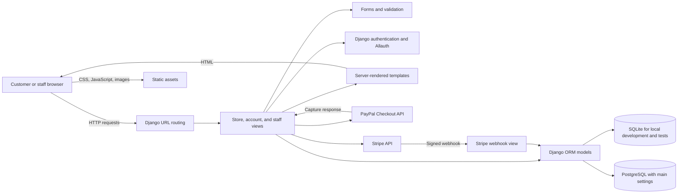
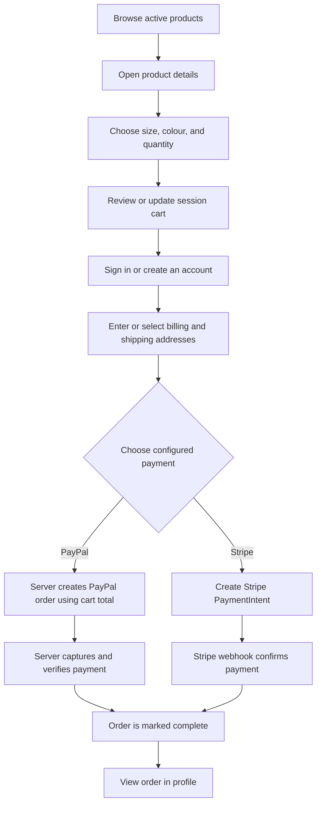

<div align="center">

# Django E-Commerce Store

An open-source Django storefront for browsing products, managing a session cart, checking out with customer accounts, and connecting PayPal or Stripe payments.

**Repository:** [channallikrishnasai/Ecommerce_Store](https://github.com/channallikrishnasai/Ecommerce_Store) ·
[GitHub profile](https://github.com/channallikrishnasai)


> **Project status:** Development / portfolio project. The local application and automated tests run, but payment-provider credentials, production infrastructure, and live payment flows have not been verified. This project is **not production-ready**.

</div>

## Table of contents

- [Project overview](#project-overview)
- [Feature matrix](#feature-matrix)
- [Technology stack](#technology-stack)
- [Application architecture](#application-architecture)
- [Customer journey](#customer-journey)
- [Feature details](#feature-details)
- [Project structure](#project-structure)
- [Requirements](#requirements)
- [Installation](#installation)
- [Environment configuration](#environment-configuration)
- [Payment configuration](#payment-configuration)
- [Screenshots](#screenshots)
- [Testing and quality assurance](#testing-and-quality-assurance)
- [Security](#security)
- [Troubleshooting](#troubleshooting)
- [Command reference](#command-reference)
- [Automation](#automation)
- [Roadmap](#roadmap)
- [Contributing](#contributing)
- [Status and limitations](#status-and-limitations)
- [Attribution and license](#attribution-and-license)
- [Developer contact](#developer-contact)
- [Acknowledgments](#acknowledgments)

## Project overview

Django E-Commerce Store is a server-rendered online shop. Visitors can browse the active catalog, view product variants, and build a cart. Customers sign in before entering shipping and billing details; the application then presents configured payment options and stores completed orders in the account history.

The project is intended as a learning and portfolio codebase for Django developers exploring the structure of a small online store. Staff users manage products and review orders through the application's staff pages and Django admin.

The codebase began as [Flavio Oliveira's `django_ecommerce` project](https://github.com/fl4viooliveira/django_ecommerce). This repository is a separately published copy with its original MIT license and attribution retained. Verified changes made in this repository include maintained dependency ranges, safer settings, checkout and cart access controls, server-authoritative PayPal order handling, responsive storefront refinements, tests, CI, and documentation.

## Feature matrix

| Feature | Description | Status | Main implementation |
| --- | --- | --- | --- |
| Product catalog | Lists active products and filters by category | Implemented | [`cart/views.py`](cart/views.py), [`templates/cart/product_list.html`](templates/cart/product_list.html) |
| Product details | Shows description, price, stock, and available variants | Implemented | [`cart/views.py`](cart/views.py), [`templates/cart/product_detail.html`](templates/cart/product_detail.html) |
| Shopping cart | Session-associated cart with quantity and remove actions | Implemented | [`cart/models.py`](cart/models.py), [`cart/views.py`](cart/views.py) |
| Customer accounts | Email-based sign-up, sign-in, verification, and profile | Implemented | Django Allauth, [`core/views.py`](core/views.py) |
| Checkout | Authenticated customers select or enter shipping and billing addresses | Implemented | [`cart/forms.py`](cart/forms.py), [`cart/views.py`](cart/views.py) |
| PayPal | Server creates and captures orders, then checks provider response against the local total | Integrated; credentials and provider flow not tested here | [`cart/views.py`](cart/views.py), [`templates/cart/payment.html`](templates/cart/payment.html) |
| Stripe | PaymentIntent, saved-card, and signed webhook paths are present | Integrated; credentials and provider flow not tested here | [`cart/views.py`](cart/views.py), [`templates/cart/stripe_payment.html`](templates/cart/stripe_payment.html) |
| Order history | Customers can see their completed orders and order details | Implemented | [`core/views.py`](core/views.py), [`cart/views.py`](cart/views.py) |
| Staff tools | Staff-only order listing and product create, update, and delete pages | Implemented | [`staff/views.py`](staff/views.py), [`staff/forms.py`](staff/forms.py) |
| Contact form | Validates a message and sends it to the configured notification address | Implemented; SMTP configuration required outside local development | [`core/views.py`](core/views.py), [`core/forms.py`](core/forms.py) |

## Technology stack

| Technology | Purpose | Where it is used |
| --- | --- | --- |
| Python 3.12+ | Application runtime | Django project and CI |
| Django 5.2 LTS | Web framework, ORM, admin, sessions, forms, and tests | `ecom/`, `cart/`, `core/`, `staff/` |
| Django Allauth | Email-based account flows | `/accounts/` |
| Django Crispy Forms + Bootstrap 4 template pack | Form rendering | Checkout, catalog management, and account templates |
| SQLite | Local development and automated tests | `ecom/settings/local_example.py` |
| PostgreSQL | Main-settings database backend | `ecom/settings/main.py` |
| Stripe Python SDK | PaymentIntent creation and webhook signature verification | `cart/views.py` |
| PayPal Checkout API | Server-side order creation and capture | `cart/views.py` |
| HTML, CSS, JavaScript, Bootstrap assets | Server-rendered storefront and browser interactions | `templates/`, `static/` |
| Gunicorn + gevent | WSGI application server configuration | `Dockerfile`, `ecom/gunicorn.py` |
| GitHub Actions | Compilation, Django checks, and tests | `.github/workflows/django.yml` |

## Application architecture



`manage.py` uses the local SQLite settings by default. WSGI deployments use the main settings unless `DJANGO_SETTINGS_MODULE` is set explicitly. The main settings use PostgreSQL configuration and production-oriented HTTPS cookie and redirect defaults.

## Customer journey



Checkout requires an authenticated customer. Payment options are only shown when their credentials are configured. A successful end-to-end transaction has not been exercised against either provider in this repository's test environment.

## Feature details

### Catalog and product management

The shop lists active products and supports filtering by category. Product pages show a product description, price, stock count, and the sizes and colours configured for that product. Staff pages provide product create, update, and delete forms; staff can set product visibility, stock, category, and variations.

### Cart and checkout

The cart is associated with an order ID in the visitor's Django session. Add, decrement, increment, and remove operations are POST actions. Each cart mutation is scoped to the current session's open order. Checkout requires login and collects or selects addresses belonging to that customer.

The price is stored in the product model as a decimal value interpreted by the existing application as minor currency units (for example, `1250` is rendered as `$12.50`). Shipping charges, taxes, and discounts are not currently calculated.

### Accounts and orders

Django Allauth provides email-based authentication and mandatory email verification. Customers can view completed orders from their profile. Order detail pages are restricted to the customer who owns the order.

### Payments

- **PayPal:** the browser asks the server to create an order using the server-calculated total. After approval, the server captures the PayPal order and checks its completion status, currency, amount, and local order reference before marking the order paid.
- **Stripe:** a PaymentIntent and saved-card flow are present. The webhook verifies Stripe's signature before it updates a payment and order.
- Both providers require merchant-side configuration. Credentials and real or sandbox transactions were not available for this verification, so payment operation is **not guaranteed**.

### Contact and staff

The contact form sends an email to `NOTIFY_EMAIL` using Django's configured mail backend. Local development prints mail to the console. The staff area is restricted to authenticated staff users; the Django admin is also available at `/admin/`.

## Project structure

```text
.
├── .github/workflows/       # CI workflow
├── cart/                    # Catalog, cart, checkout, orders, and payments
│   ├── migrations/          # Database schema history
│   └── templatetags/         # Cart count template filter
├── core/                    # Home, profile, contact, and customer signal
├── ecom/                    # Django project, settings, URLs, WSGI, ASGI
│   └── settings/
├── staff/                   # Staff-only product and order views
├── static/                  # CSS, JavaScript, fonts, icons, and images
├── templates/               # Storefront, account, cart, and staff templates
├── tests/                   # Automated Django tests
├── .env.example             # Safe local environment-variable template
├── Dockerfile               # Gunicorn container image
├── manage.py                # Django management entry point
├── requirements.in          # Direct dependency ranges
└── requirements.txt         # Install entry point for requirements.in
```

## Requirements

- Python 3.12 or later (the CI matrix covers Python 3.12 and 3.14).
- `pip` and Python virtual-environment support.
- SQLite for local development and tests; no local database server is needed.
- PostgreSQL and its connection settings when using `ecom.settings.main`.
- PayPal and/or Stripe credentials only when you want to exercise those payment integrations.

Direct dependency ranges are declared in [`requirements.in`](requirements.in) and installed through [`requirements.txt`](requirements.txt). The dependency file is range-constrained, not a fully pinned lockfile.

## Installation

### 1. Clone and enter the existing repository

```bash
git clone https://github.com/channallikrishnasai/Ecommerce_Store.git
cd Ecommerce_Store
```

### 2. Create and activate a virtual environment

**Windows PowerShell**

```powershell
py -3.12 -m venv .venv
.\.venv\Scripts\Activate.ps1
```

**Windows Command Prompt**

```bat
py -3.12 -m venv .venv
.\.venv\Scripts\activate.bat
```

**Linux or macOS**

```bash
python3.12 -m venv .venv
source .venv/bin/activate
```

### 3. Install dependencies and configure local settings

```bash
python -m pip install --upgrade pip
python -m pip install -r requirements.txt
```

Copy the environment example and replace its development secret with a unique value:

```bash
cp .env.example .env
python -c "from django.core.management.utils import get_random_secret_key; print(get_random_secret_key())"
```

Paste the generated value into `.env` as `SECRET_KEY=...`. On Windows, copy the file with `Copy-Item .env.example .env` in PowerShell or `copy .env.example .env` in Command Prompt. The `.env` file is ignored by Git.

### 4. Migrate and verify the project

```bash
python manage.py migrate
python manage.py check
python manage.py test
```

### 5. Create an administrator and run the server

```bash
python manage.py createsuperuser
python manage.py runserver
```

Open `http://127.0.0.1:8000/`. Local management commands default to `ecom.settings.local_example`, which uses SQLite, the console email backend, and HTTP-friendly cookie settings. It is a development configuration and must not be used for a public deployment.

### Optional Docker run

The Docker image runs Gunicorn with `ecom.settings.main` and therefore expects deployment-style environment values and a reachable PostgreSQL database. Do not pass the local SQLite example as a production configuration.

```bash
docker build -t ecommerce-store .
docker run --rm --env-file .env -p 8000:8000 ecommerce-store
docker run --rm --env-file .env ecommerce-store python manage.py migrate
```

For a container, set `DATABASE_HOST` to the PostgreSQL service hostname reachable from that container. Static files still need a configured static server or storage service.

## Environment configuration

The settings read a root-level `.env` file through `django-environ`; process environment variables can also supply settings. Start from [`.env.example`](.env.example), which contains placeholders only.

| Variable | Purpose | Local default / guidance |
| --- | --- | --- |
| `SECRET_KEY` | Django signing and cryptographic key | Generate a unique value; never publish it |
| `DEBUG` | Enables Django debug behavior | Local settings enable debug; set `False` for deployment |
| `ALLOWED_HOSTS` | Allowed request hostnames | Localhost values in local settings; set production domains |
| `DATABASE_NAME` | Main-settings PostgreSQL database name | `django_ecommerce` |
| `DATABASE_USER` | PostgreSQL user | `postgres` |
| `DATABASE_PASSWORD` | PostgreSQL password | Empty by default; set a deployment secret |
| `DATABASE_HOST`, `DATABASE_PORT` | PostgreSQL endpoint | `localhost`, `5432` |
| `DEFAULT_FROM_EMAIL` | Sender for contact messages | Configure for the selected mail service |
| `NOTIFY_EMAIL` | Contact form recipient | Set a monitored mailbox |
| `EMAIL_HOST`, `EMAIL_PORT` | SMTP server endpoint | `localhost`, `25` in main settings |
| `EMAIL_HOST_USER`, `EMAIL_HOST_PASSWORD` | SMTP credentials | Supply through a secret manager in deployment |
| `EMAIL_USE_TLS`, `EMAIL_USE_SSL` | SMTP transport options | Do not enable both |
| `PAYPAL_ENV` | PayPal API environment | `sandbox` locally; use `live` only for a deliberate production setup |
| `PAYPAL_SANDBOX_CLIENT_ID`, `PAYPAL_SANDBOX_SECRET_KEY` | Local PayPal sandbox credentials | Optional; leave blank until configured |
| `PAYPAL_CLIENT_ID`, `PAYPAL_SECRET_KEY` | PayPal credentials in main settings | Supply as protected deployment secrets |
| `STRIPE_PUBLIC_KEY` | Stripe.js publishable key | Use a Stripe test-mode key for development |
| `STRIPE_SECRET_KEY` | Stripe server API key | Secret; do not expose to browser or commit |
| `STRIPE_WEBHOOK_SECRET` | Stripe webhook signature secret | Configure separately for each webhook endpoint |

Local settings use SQLite regardless of the PostgreSQL variables. Main settings use PostgreSQL. Set `DJANGO_SETTINGS_MODULE=ecom.settings.main` explicitly when running commands or WSGI in a deployment.

## Payment configuration

### PayPal sandbox

1. Create sandbox REST API credentials in the PayPal developer dashboard.
2. Set `PAYPAL_ENV=sandbox`, `PAYPAL_SANDBOX_CLIENT_ID`, and `PAYPAL_SANDBOX_SECRET_KEY` in the ignored `.env`.
3. Sign in to the application, add an item, complete checkout, and select PayPal.
4. Configure merchant sandbox accounts and verify the provider's order creation, approval, capture, and application order history manually.

The PayPal client ID is used by the browser SDK; the secret remains server-side. The application creates and captures the order through the PayPal API, and does not accept the browser's stated payment amount as proof of payment.

### Stripe test mode

Set `STRIPE_PUBLIC_KEY`, `STRIPE_SECRET_KEY`, and `STRIPE_WEBHOOK_SECRET` to test-mode values. For local webhook testing, point the Stripe CLI at `/cart/webhooks/stripe/` and use the endpoint secret it provides. Never use live credentials for local testing.

The presence of code and configuration does not establish that provider payments work in a given merchant account. Neither integration was exercised against the external payment APIs as part of the automated test run.

## Screenshots

There are no genuine application screenshots in the repository. The tracked images are branding, icons, and site assets; they are not presented as application screenshots.

To capture real screenshots after launching the local app, create a `screenshots/` folder and capture:

- Home page at desktop and narrow/mobile widths.
- Product listing and a product detail page.
- Cart with an item and the empty-cart state.
- Authenticated checkout and the payment-choice page.
- Staff product management page.

Use non-sensitive sample data and do not include customer information, payment details, or credentials.

## Testing and quality assurance

Commands run in the current Codespace using Python 3.14.2 and the isolated dependencies:

| Check | Result |
| --- | --- |
| `python -m compileall -q cart core ecom staff manage.py tests` | Passed |
| `python manage.py check --settings=ecom.settings.local_example` | Passed; no issues reported |
| `python manage.py makemigrations --check --dry-run --settings=ecom.settings.local_example` | Passed; no model changes pending |
| `python -m pip check` | Passed; no broken requirements |
| `python manage.py test --settings=ecom.settings.local_example` | Passed: 8 tests |
| PayPal / Stripe live or sandbox transactions | Not run; provider credentials and external transaction setup were unavailable |
| Production deployment check / PostgreSQL connection | Not run; no production host or PostgreSQL service was configured |

Automated tests cover public catalog visibility, checkout authentication, order privacy, session-scoped cart mutations, PayPal server-side order amount creation, and server-verified PayPal capture behavior using mocked provider responses. They do not replace provider sandbox tests or a deployment review.

## Security

- **Secrets:** `.env` files are ignored. Keep production secrets in the hosting platform's secret manager; never commit `.env`, payment credentials, or customer data.
- **Django settings:** `ecom.settings.local_example` is local-only. Main settings default to `DEBUG=False`, require explicit host configuration for normal serving, and use secure cookies, HTTPS redirection, HSTS, and a same-origin referrer policy. Run `python manage.py check --deploy` with the actual deployment environment before release.
- **Proxy configuration:** main settings trust `HTTP_X_FORWARDED_PROTO`; deploy only behind a trusted proxy that overwrites this header.
- **Payments:** PayPal capture is requested and checked server-side. Stripe webhook requests require a valid signature. Protect webhook secrets and test both providers with sandbox/test credentials before accepting payments.
- **Cart and orders:** mutating cart endpoints use POST and are scoped to the session's open order. Checkout and payment require authentication; order detail pages are scoped to their owner.
- **Database:** use a dedicated PostgreSQL role with limited privileges and protected network access in production. Do not use the local SQLite database for a multi-worker deployment.
- **Dependencies and operations:** dependencies have maintained version ranges but are not fully locked. Review and update them regularly. Configure HTTPS, backups, static-file serving, database migrations, monitoring, and secure email before deployment.

## Troubleshooting

| Symptom | Likely cause | Suggested fix |
| --- | --- | --- |
| `ModuleNotFoundError: No module named 'django'` | The virtual environment is inactive or dependencies are missing | Activate `.venv` and run `python -m pip install -r requirements.txt` |
| `SECRET_KEY` or host errors in deployment | Main settings are running without deployment values | Set a private `SECRET_KEY` and `ALLOWED_HOSTS`; do not use the local settings module |
| PostgreSQL connection error | Main settings are selected but the database or credentials are unavailable | Start PostgreSQL and verify `DATABASE_NAME`, `DATABASE_USER`, `DATABASE_PASSWORD`, `DATABASE_HOST`, and `DATABASE_PORT` |
| PayPal option is not shown | PayPal credentials are missing | Set the sandbox credential pair in local `.env`; restart the server |
| PayPal cannot create or confirm an order | Credentials, sandbox account state, or API connectivity is incorrect | Check sandbox credentials and server logs; never log or share the secret key |
| Stripe payment page is unavailable | Stripe keys are missing or the payment flow reached without checkout | Configure Stripe test keys and complete checkout first |
| Contact messages are not delivered | SMTP settings or `NOTIFY_EMAIL` are unset | Configure SMTP transport, sender, and recipient; local development writes mail to the console |
| Images or CSS are absent in deployment | Static/media assets are not served by Gunicorn | Run `collectstatic` and configure a trusted static/media server or storage backend |
| Product does not appear in the shop | The product is inactive or unavailable | Use staff product management to activate it and set stock |
| Database migration is pending | Model state changed without an applied migration | Review `python manage.py makemigrations`, then apply with `python manage.py migrate` |

## Command reference

| Command | Purpose |
| --- | --- |
| `python -m pip install -r requirements.txt` | Install application dependencies |
| `python manage.py runserver` | Start the local development server |
| `python manage.py check` | Run Django system checks |
| `python manage.py check --deploy` | Run deployment-focused checks with production settings selected |
| `python manage.py makemigrations` | Generate migrations after intentional model changes |
| `python manage.py migrate` | Apply database migrations |
| `python manage.py createsuperuser` | Create a Django admin user |
| `python manage.py test` | Run automated tests |
| `python -m compileall -q cart core ecom staff manage.py tests` | Compile-check the Python modules |
| `python manage.py collectstatic --noinput` | Collect static assets for a deployment static server |
| `DJANGO_SETTINGS_MODULE=ecom.settings.main gunicorn ecom.wsgi:application -c ecom/gunicorn.py` | Start the WSGI app with main settings on Linux/macOS |

## Automation

The [Django checks workflow](.github/workflows/django.yml) runs on pushes and pull requests. It uses Python 3.12 and 3.14, installs the declared dependencies, compiles the Python modules, runs Django system checks with local SQLite settings, and executes the test suite. The workflow has been added to the repository; no remote GitHub Actions run result is claimed here.

## Roadmap

| Proposed improvement | Expected benefit | Status |
| --- | --- | --- |
| Add inventory reservation and decrement stock only after verified payment | Reduce overselling and keep availability accurate | Planned |
| Add immutable order-line price snapshots | Keep historical order totals stable after catalog price changes | Planned |
| Add expanded checkout, account, staff, and Stripe webhook tests | Catch regressions across the remaining workflows | Planned |
| Add a real responsive screenshot gallery | Show the running application with verified project screenshots | Planned |
| Add production static/media storage and deployment guidance | Make deployment behavior explicit and repeatable | Planned |
| Pin and automate dependency updates | Improve reproducibility and maintenance visibility | Planned |

## Contributing

1. Fork or clone this repository and create a focused branch:

   ```bash
   git switch -c feature/your-change
   ```

2. Make a small, tested change and add or update relevant tests.
3. Install dependencies, then run:

   ```bash
   python -m compileall -q cart core ecom staff manage.py tests
   python manage.py check
   python manage.py test
   ```

4. Review your diff, ensure `.env` and other secrets are not included, and open a pull request with a clear description.

Please preserve the upstream attribution and MIT license when distributing substantial portions of the original code.

## Status and limitations

- This is a development and portfolio application, not a production-certified store.
- Payment credentials were not available, so PayPal and Stripe transactions have not been tested against provider services.
- Stock is checked when adding or increasing cart quantities but is not reserved or decremented after payment.
- Order item prices are calculated from the current product price rather than an immutable price snapshot.
- Shipping rates, tax, discounts, refunds, and automated fulfillment are not implemented.
- Production PostgreSQL connectivity, email delivery, static/media hosting, and deployment hardening still require environment-specific validation.
- The repository contains no captured application screenshots.

## Attribution and license

The original project is by [Flavio Oliveira](https://github.com/fl4viooliveira) and was sourced from [fl4viooliveira/django_ecommerce](https://github.com/fl4viooliveira/django_ecommerce). This repository is a separate publication of that existing project with the changes described in this README; it does not claim independent authorship of the original implementation.

The upstream [MIT License](LICENSE) is retained. Preserve its copyright and permission notice in copies or substantial portions of the software.

## Developer contact

- **GitHub:** [channallikrishnasai](https://github.com/channallikrishnasai)
- **Email:** [channallikrishnasai@gmail.com](mailto:channallikrishnasai@gmail.com)

## Acknowledgments

Thanks to Flavio Oliveira for the original Django e-commerce project, and to the Django, Django Allauth, Bootstrap, Stripe, and PayPal projects and communities. Their respective names and software remain subject to their own trademarks and licenses.
